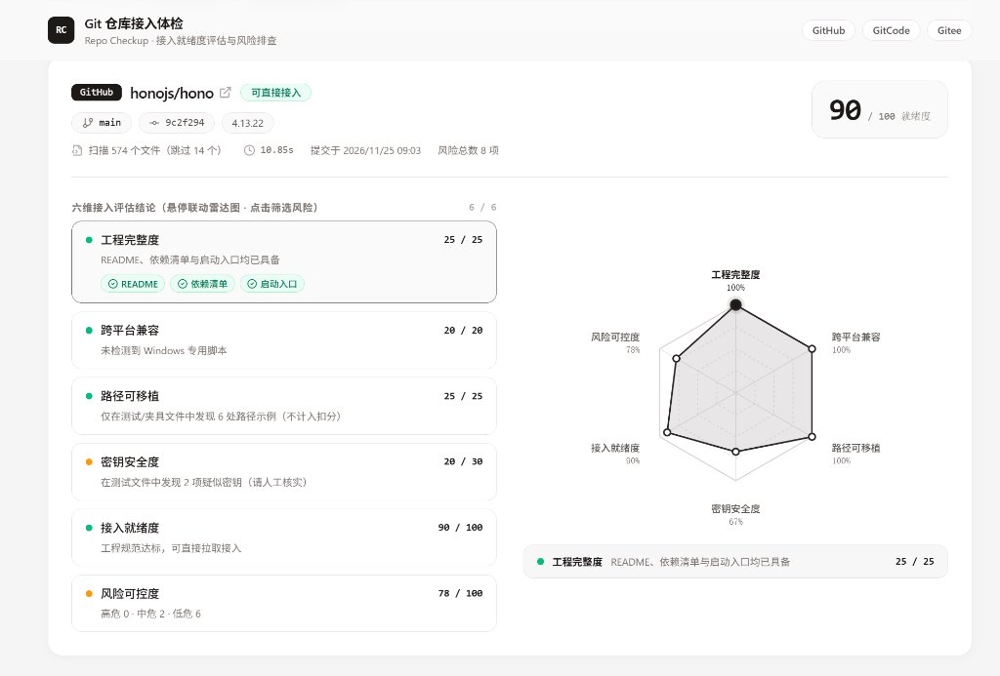
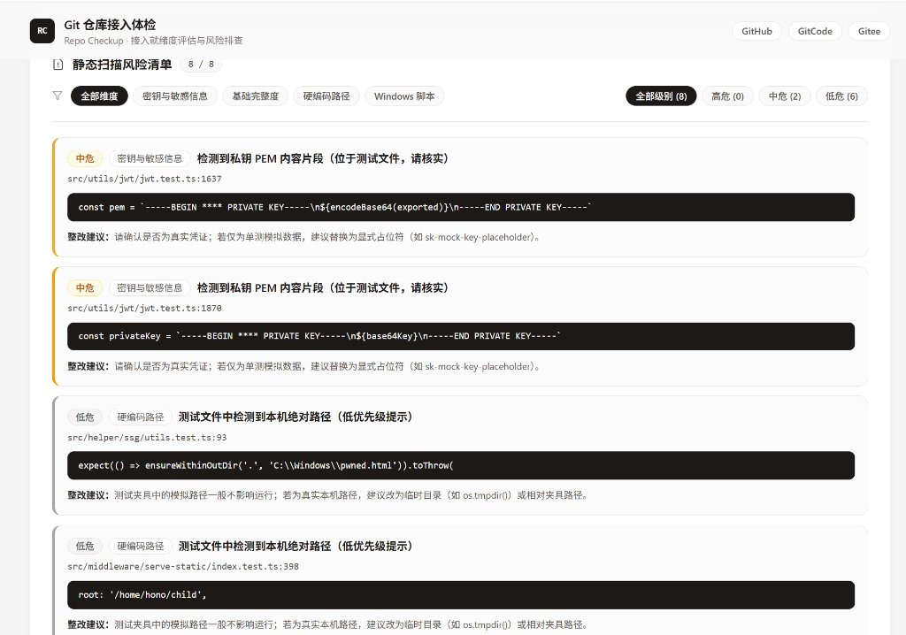

# Repo Checkup（Git 仓库接入体检工具）

一个面向“外部或存量项目准备接入前”的轻量级全栈 TypeScript Web 体检工具。用户在页面上输入公开的 **GitHub**、**GitCode** 或 **Gitee** 仓库链接（默认扫描默认分支，支持通过 `/tree/<branch>` 指定分支），系统自动完成浅克隆与静态检测，以可视化雷达图与风险清单评估接入就绪度，并支持按需手动调用 OpenAI 兼容模型生成 AI 改进建议。

---

## 界面预览

### 六维评估总览与能力雷达图



### 静态扫描风险清单（支持维度与级别筛选、敏感片段脱敏）



---

## 核心功能

1. **多平台支持与实时进度条**
   - 统一兼容 **GitHub**、**GitCode**（含 `gitcode.com` / `gitcode.net`）、**Gitee** 公开 `https://` 仓库链接，支持 `/tree/<branch>` 与 `/-/tree/<branch>` 分支解析。
   - 基于 `git clone --depth 1 --single-branch --progress` 与 SSE（`POST /api/scan/stream`），在前端以游戏加载风格横向进度条实时展示 `0%–100%` 拉取与分析进度；提取分支与 Commit 快照后立即清理 `.git` 与临时目录（同时兼容 Windows 只读包文件与 macOS 权限清理）。
2. **四大静态体检维度（总分 100 分）**
   - **基础完整度（25 分）**：检测根目录 `README`、常见技术栈依赖清单（`package.json`、`pom.xml`、`requirements.txt`、`pyproject.toml`、`go.mod`、`Cargo.toml` 等）及启动脚本/容器入口。
   - **Windows 专用脚本（20 分）**：排查 `.bat`、`.cmd`、`.ps1`、`.vbs` 文件；若同目录存在等价 Shell/跨平台入口（如 `gradlew` 对应 `gradlew.bat`）则自动降级为低危提示。
   - **硬编码路径（25 分）**：检测源码与配置中的 `C:\`、`D:/Users/...`、`/Users/...`、`/home/...`、`/root/...` 绝对路径（排除纯文档与中文标点误判，测试夹具降级为低危不扣分）。
   - **密钥与敏感信息风险（30 分，高危阻塞项）**：检测直接入库的 `.env`（放行 `.env.example` / `.env.sample` / `.env.template`）、私钥/证书文件及代码中的 `sk-`、`AKID`、`AKIA`、`Bearer`、PEM 私钥头，在服务端完成自动脱敏后返回前端。
3. **六维能力雷达与风险清单**
   - 前端将检测结论聚合为 6 个维度（工程完整度、跨平台兼容、路径可移植、密钥安全度、接入就绪度、风险可控度），采用**左栏结论列表 + 右侧 SVG 六边形雷达图**悬停联动展示，支持按维度与高/中/低危筛选风险明细。
4. **手动触发 AI 建议（OpenAI 兼容接口）**
   - 独立于主扫描流程，仅在用户手动点击「生成 AI 建议」后触发，完全不拖慢原有扫描速度。
   - 优先读取本地 `.env` 配置；若未配置仅做温和提示，不阻断主报告查看。支持页面填写 `Base URL`（内置 **DeepSeek / Kimi / GLM** 一键快捷填入）与 `API Key`，支持拉取可用 Model 列表或手动填写模型名称，并支持一键「保存到本地 .env」。
   - 生成独立 **AI 评分** 与 **3–5 条**按风险优先级排序的精简卡片（标题 + 严重程度标签 + 大白话摘要），点击卡片可在右侧抽屉查看详细改造方案。

---

## 本地启动方式

### 前置要求

- **Node.js** `>= 20`（本地开发环境使用 `v24.19.0`）
- **pnpm** `>= 10`（本地开发环境使用 `11.21.0`）
- **Git** 命令行工具（需在系统 `PATH` 中可用）

### 1. 安装依赖

```bash
pnpm install
```

### 2. 配置环境变量（可选，用于 AI 建议）

项目根目录提供了 [.env.example](./.env.example) 模板文件：

```dotenv
# OpenAI 兼容接口配置（可选：不配也可以在页面上手动填写）
AI_BASE_URL=https://api.openai.com/v1
AI_API_KEY=
AI_MODEL=gpt-4o-mini
```

你可以任选以下一种方式配置（`.env` 已加入 `.gitignore`，不会提交到 Git 仓库）：

- **方式 A（命令行配置）**：复制模板为 `.env` 并填入你的 `AI_BASE_URL`、`AI_API_KEY`、`AI_MODEL`；
- **方式 B（页面保存）**：直接启动项目后，在页面「AI 智能接入建议 → 接口与模型设置」中点击 **DeepSeek / Kimi / GLM** 或填入自定义地址与 Key，点击 **「保存到本地 .env」** 即可自动写入并即时生效。

### 3. 启动与校验命令

```bash
# 同时启动前后端开发服务（前端 http://localhost:5173 ，后端 http://localhost:3001）
pnpm dev

# 分别启动后端 / 前端
pnpm dev:server
pnpm dev:web

# 构建全部工作区包（shared -> server -> web）
pnpm build

# 全量 TypeScript 类型检查
pnpm typecheck

# 运行单元测试（Vitest）
pnpm test
```

---

## 更新跟踪设计说明

围绕“持续跟踪外部已接入仓库的变化”这一实际诉求，系统在“发现更新、增量重算、版本溯源、异常兜底”四个环节采用如下架构设计：

### 1. 原仓库有新代码提交时，如何发现更新？

- **轻量级 `git ls-remote` 远端指针探测（主力方案）**：对已登记的仓库周期性执行 `git ls-remote <cloneUrl> refs/heads/<branch>`，仅向远端请求几十字节的引用指针，即可拿到目标分支最新 `HEAD` 的 40 位 Commit SHA，与本地记录的 `lastScannedCommitSha` 比对是否发生变化。该方式**同时兼容 GitHub / GitCode / Gitee**，无需分别为三家平台维护不同的 REST API 鉴权与分页逻辑。
- **平台 Webhook + ETag 条件轮询（补充方案）**：对于托管平台可配置的仓库，优先接收平台 `push` Webhook 事件实现秒级感知；针对第三方开源仓库的定时巡检，在调用平台接口时携带 `If-None-Match`（ETag），未更新时返回 `304 Not Modified` 不消耗限流配额。

### 2. 如何避免每次更新都全量重算？

采用**「Commit 级报告缓存 + 文件级 Diff 增量扫描」**两级缓存策略：

1. **Commit 级命中直接复用**：以 `(platform, owner, repo, branch, commitSha, scannerVersion)` 作为缓存键。若远端 `HEAD` SHA 与上次一致且扫描规则版本未升级，直接返回缓存报告，零克隆、零计算。
2. **基于 `git diff` 的文件级增量重算**：当检测到 `oldSha -> newSha` 存在新提交时：
   - 对变更集执行 `git diff --name-status <oldSha>..<newSha>`，拆分为新增（`A`）、修改（`M`）、删除（`D`）与重命名（`R`）文件清单；
   - **逐文件型规则**（Windows 脚本识别、硬编码路径检测、密钥与 `.env` 扫描）仅对 `A` / `M` 涉及的文件重新执行，直接删除 `D` 文件的旧风险项，其余未变更文件直接复用上一次扫描缓存的 `RiskItem[]`；
   - **仓库聚合型规则**（基础完整度）基于更新后的文件目录树与变更的清单文件（如 `package.json`）做轻量重算，最终由 `buildScanReport` 重新汇总总分与评级。

### 3. 报告中如何标注所基于的 Commit？

该能力**已在当前版本落地实现**：

- 后端在完成浅克隆后、清理 `.git` 目录前，通过 `git symbolic-ref --short HEAD` 与 `git log -1 --format=%H%n%h%n%cI%n%s` 提取完整提交快照，随报告返回 `RepoMetadata`：
  - `scannedBranch`：实际扫描的分支名（如 `main`）
  - `commitSha`：完整 40 位 Commit SHA
  - `commitShortSha`：7 位短哈希
  - `commitMessage` 与 `commitDate`：该提交的摘要与时间
- 前端 [ScoreOverview.tsx](./web/src/components/ScoreOverview.tsx) 在报告顶部固定展示 **分支标签 + Commit 短哈希（悬停可查看完整 40 位 SHA）+ 提交信息 + 提交时间**，确保每一份体检结论都能精确追溯到唯一代码快照。

### 4. 拉取失败或接口限流时如何兜底？

- **协议层规避限流**：核心拉取链路使用 `git clone --depth 1` 与 `git ls-remote`，天然避开了 GitHub 未登录 REST API 每小时 60 次的严苛限流；同时注入 `GIT_TERMINAL_PROMPT=0` 与 `GIT_ASKPASS=echo`，防止私有库或异常链接触发交互式鉴权阻塞。
- **超时控制与指数退避重试**：单次克隆设置严格超时（45s）并在 `finally` 中跨平台强制回收临时目录；遇到网络抖动、HTTP `429` / `5xx` 时执行有限次数的指数退避重试（如 `1s → 3s → 9s`），并区分返回清晰的中文错误码（`REPO_NOT_FOUND`、`BRANCH_NOT_FOUND`、`CLONE_TIMEOUT`）。
- **Stale-While-Error 缓存兜底**：当本次更新拉取或定时重扫失败时，不覆盖已有数据，而是保留并展示最近一次成功的体检报告，同时在页面顶部显式标注**「拉取最新提交失败，当前展示基于历史 Commit `<shortSha>` 的缓存报告（可能已过期）」**并提供手动重试按钮。

---

## 目录结构

```text
repo-checkup/
├── shared/        # 前后端共享 TypeScript 类型定义 (@repo-checkup/shared)
├── server/        # Hono + Node.js 后端服务、Git 克隆与插件化扫描引擎 (@repo-checkup/server)
├── web/           # React 19 + Vite 6 + Tailwind CSS v4 前端工作台 (@repo-checkup/web)
├── docs/images/   # README 展示截图
├── .env.example   # 本地 AI 配置环境变量模板
├── AI_USAGE.md    # Vibe Coding 协作与真实调优记录
└── README.md      # 项目说明与架构设计文档
```

---

## 后续演进方向

- **扩展封装为 MCP（Model Context Protocol）工具**：将扫描引擎与评分能力封装为标准 MCP Server，使 IDE 或 Coding Agent 在准备拉取、引入外部仓库前可直接通过工具调用完成接入体检并自动读取风险清单。
- **持久化缓存与增量跟踪落地**：引入 SQLite / Redis 存储历次扫描快照，落地上述基于 `git ls-remote` + `git diff` 的自动跟踪与对比视图。
- **私有仓库与历史泄露扫描**：支持用户临时授权只读 PAT 拉取私有仓库，并可选开启浅层历史 Commit 密钥追溯。
- **报告导出与 CI 门禁**：支持导出 Markdown / JSON 接入评审单，以及提供 CLI 模式作为 PR 准入检查步骤。
